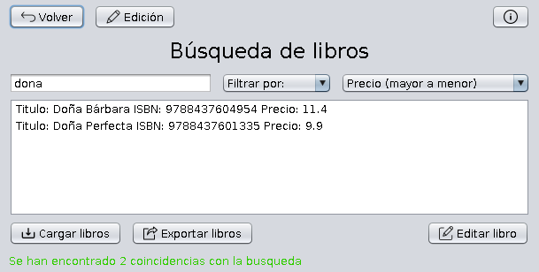
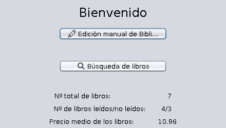
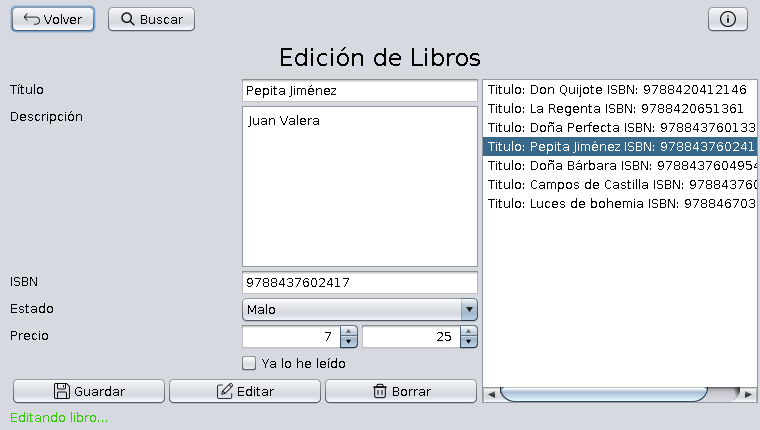
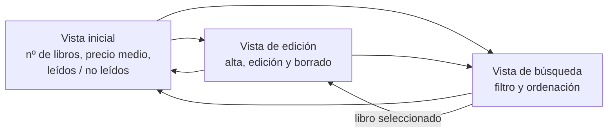

<div align="center">

# Biblioteca de libros con Java Swing

**Aplicación de escritorio con tres vistas para gestionar una biblioteca: estadísticas, edición, búsqueda sin tildes ni mayúsculas, e importación y exportación a fichero**


<sub>Interacción Persona-Computadora (entrega 2) · Grado en Ingeniería Informática · Universidad de Valladolid · Curso 2022-2023</sub>

</div>

<p align="center">
  
</p>

## En pocas palabras

- **Reto**: ampliar un gestor de libros a una aplicación de varias ventanas, con búsqueda útil para el usuario y datos que se puedan guardar y recuperar.
- **Solución**: tres vistas Swing (inicio, edición y búsqueda) coordinadas por un gestor de vistas, un modelo único compartido e importación/exportación en ficheros `.txt`.
- **Demuestra**: arquitectura MVC con varios controladores, diseño de interfaces y usabilidad, E/S de ficheros con validación y normalización de texto Unicode.

## Lo más destacado

- **Búsqueda tolerante**: el texto se normaliza con `java.text.Normalizer` (NFD) y se eliminan las marcas diacríticas (`\p{M}`), así que "codigo" encuentra "Código"; busca por título, por ISBN o por ambos.
- **Cinco órdenes de resultados**: inserción, alfabético ascendente o descendente y precio ascendente o descendente (`Comparable<ReferenciaLibro>`, `Arrays.sort`, `Collections.reverse`).
- **Importación validada**: comprueba que cada línea tenga seis campos y un precio numérico, rechaza ISBN duplicados e informa de cuántos libros ha añadido de cuántas entradas.
- **MVC con modelo compartido**: `Biblioteca` guarda la lista completa y la lista resultado de la búsqueda; cada vista tiene su controlador (`ControladorInicial`, `ControladorEdicion`, `ControladorBusqueda`).
- **Gestión de ventanas**: `GestorVistas` libera la vista actual (`dispose`) antes de abrir la siguiente, la centra en pantalla y le fija un tamaño mínimo.
- **E/S con `try-with-resources`** (`BufferedReader`, `BufferedWriter`) y un botón de ayuda con los atajos de teclado.

## Competencias

| Área | Qué se aplicó |
| --- | --- |
| Interfaces gráficas | Swing con apariencia Nimbus, `JFileChooser`, iconos propios y formularios del editor visual de NetBeans |
| Usabilidad (IPC) | Navegación entre vistas, estadísticas en la vista inicial, ayuda con atajos, mensajes de resultado |
| Diseño de software | MVC con un modelo y tres controladores |
| Ficheros y texto | Formato `título;descripción;isbn;estado;precio;leído`, validación de entrada, normalización Unicode |
| Herramientas | Proyecto NetBeans con Ant (`build.xml`, `nbproject/`) |

## Capturas

| Vista inicial | Vista de edición | Vista de búsqueda |
| --- | --- | --- |
|  |  |  |

Capturas reales de la aplicación compilada con OpenJDK 17 (`--release 11`) y ejecutada en un servidor X virtual (Xvfb), sin gestor de ventanas, por eso no aparece la barra de título. Los siete libros son datos de ejemplo cargados en el modelo `Biblioteca` antes de abrir las vistas; la búsqueda y la ordenación son las de `ControladorBusqueda`.

## Arquitectura

Navegación entre vistas tal como la gestiona `GestorVistas` (cada vista tiene su controlador y todas comparten el modelo `Biblioteca`):



## Estructura del repositorio

```text
IPC-entrega2/
├── build.xml  manifest.mf  nbproject/   # Proyecto NetBeans/Ant
└── src/
    ├── images/                          # Iconos de los botones (PNG)
    └── com/entrega2/
        ├── main/Main.java
        ├── modelo/Biblioteca.java  ReferenciaLibro.java
        └── vista/GestorVistas.java
                  VistaInicial  VistaEdicion  VistaBusqueda   (.java + .form)
                  ControladorInicial  ControladorEdicion  ControladorBusqueda
```

Cada libro tiene título, ISBN, descripción, estado, precio y la marca "leído". El fichero de importación y exportación tiene una línea por libro con los campos separados por `;`.

## Requisitos

- JDK 11 o superior.
- Opcional: NetBeans o Apache Ant para usar `build.xml`.

## Cómo ejecutarlo

Abre la carpeta como proyecto en NetBeans y ejecútalo, o usa Ant:

```sh
ant run
```

<details>
<summary>Sin IDE ni Ant, solo con el JDK</summary>

Hay que copiar los iconos al classpath, porque se cargan como recurso `/images/...`:

```sh
javac --release 11 -d build/classes $(find src -name '*.java')
cp -r src/images build/classes/
java -cp build/classes com.entrega2.main.Main
```

</details>

## Estado y limitaciones

La compilación con `javac` y el arranque de la interfaz gráfica están comprobados con OpenJDK 17 (capturas de arriba); `ant run` no se ha probado. Detalles visibles en las capturas: los precios se muestran sin formato fijo de dos decimales (`11.4`, `9.9`), la lista de edición recorta el ISBN y, con el tamaño mínimo de la vista inicial (370x235), el botón de edición queda truncado (la captura usa una ventana algo más ancha).

## Autoría

Javier García González (`jagarci`).

---

<div align="center"><sub>Parte de <a href="https://github.com/JavivuG/UVa-Projects">UVa-Projects</a> · Javier García González</sub></div>
